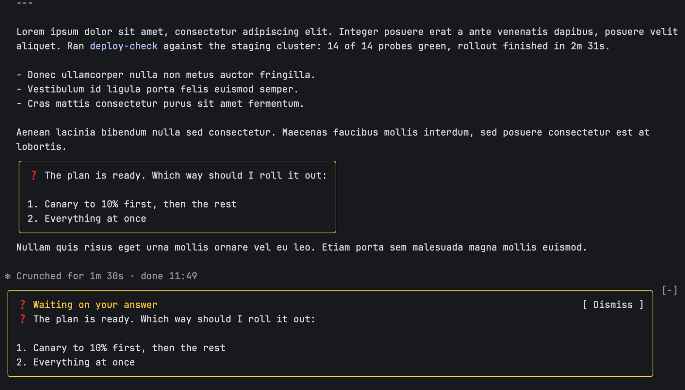
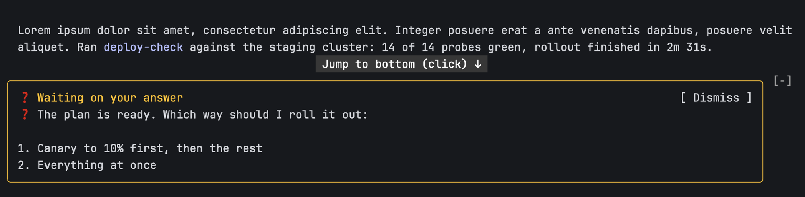

# question-highlight

A Claude Code mod that makes the questions Claude asks you easy to spot. A plan
approval or a "shall I go ahead" tends to sink between tool output and whatever
a Stop hook adds after the answer. This mod highlights them in two places:

- In the transcript, each question block is drawn inside a rounded border in
  the theme's `warning` colour.
- Above the prompt, a band titled "Waiting on your answer" repeats the latest
  questions once the turn ends, and stays until you send your next prompt or
  press Dismiss.



The band stays put while you scroll back through the transcript, so the
question is still in front of you when you come back to answer:



## Install

At the prompt of a terminal session:

```
/plugin install question-highlight --marketplace alekc/claude-question-highlight
```

Answer `y` to add the marketplace, then pick a scope (user scope loads it in
every session). From a shell:

```
claude plugin install question-highlight --marketplace alekc/claude-question-highlight
```

In the desktop app, where `/plugin` does not run: click + next to the prompt
box, then Plugins, Add marketplace with `alekc/claude-question-highlight`, then
Add plugin.

Needs a Claude Code build with mods enabled; built and tested on 2.1.318.

## Update

From a shell, refresh the marketplace, then update the plugin:

```
claude plugin marketplace update claude-question-highlight
claude plugin update question-highlight@claude-question-highlight
```

Restart Claude Code afterwards: a running session keeps the version it started
with.

## Uninstall

```
claude plugin uninstall question-highlight@claude-question-highlight
```

## What counts as a question

- A paragraph that starts with `❓`.
- A plain paragraph ending in `?`, bold or quoted included (`**Go ahead?**`).
- A list directly after either of those, as the question's options.

Headings, code fences, block quotes, tables, list items on their own, and
paragraphs starting with `🧠` (a common prefix for reasoning) never count on
their own.

A question that does not end in `?`, such as `Approve? Reply "yes" to proceed.`,
is missed unless it carries the marker. To make Claude use it, add a line like
this to your `CLAUDE.md`:

```
Start every question that waits on my answer with ❓, as its own paragraph.
```

## Development

```
claude plugin validate .
claude plugin test .
```

## License

MIT
